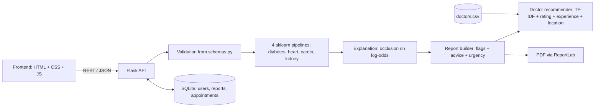

# Smart Health Monitor

A full-stack web application that screens a patient for **diabetes, heart disease, cardiovascular risk and kidney disease**
with machine-learning models, explains *why* each score was given, and ends the report with **ranked doctor suggestions**
from an additional doctor dataset.

> Screening aid for learning and demonstration. It is not a diagnosis. The bundled doctor directory is fictional.

## Quick start

```bash
pip install -r requirements.txt
python run.py            # opens on http://127.0.0.1:5000
```

`run.py` creates the doctor dataset, demo data and trained models on first launch (about a minute), then starts the server.

### Use your real datasets (important)
The project ships with **synthetic demo data** so it runs anywhere. To use the datasets from your research notebooks:

1. Copy your CSVs into `data/raw/` with these exact names, replacing the demo files (delete the matching `.demo` marker files):
   `diabetes_prediction_dataset.csv`, `heart.csv`, `Health Screening Data.csv`, `kidney_disease.csv`
2. Run `python ml/train_models.py`
3. Restart `python run.py`

The Models page and the report footer automatically switch from "demo" to "your data". Your notebook results
(`data/notebook_results.json`) are already shown on the Models page.

## Architecture



## Project structure

| Path | Purpose |
|---|---|
| `backend/schemas.py` | Single source of truth: every feature, range, option, threshold, specialist |
| `backend/predictor.py` | Validation, prediction, "what raised the score" explanation |
| `backend/advice.py` | Clinical flags (ADA / AHA / WHO cut-offs) and lifestyle advice |
| `backend/recommender.py` | Doctor recommendation engine |
| `backend/app.py` | REST API and static file serving |
| `backend/db.py` | SQLite, PBKDF2 password hashing, HMAC-signed tokens |
| `backend/pdf_report.py` | Downloadable PDF report |
| `ml/train_models.py` | Same recipe as your notebooks: clean, split 80/20, 5 models, pick best by ROC-AUC |
| `ml/generate_demo_data.py` | Synthetic data with the same columns as your datasets |
| `data/doctors.csv` | Doctor dataset (62 fictional doctors, 4 specialties, 12 cities) |
| `frontend/` | Single-page app, no build step |

## How the doctor suggestion works
1. Moderate or high risk in a screening maps to its specialist (diabetes: Endocrinologist, heart and cardiovascular: Cardiologist, kidney: Nephrologist). All low: General Physician.
2. The patient's top risk factors become a text query, for example `diabetes hba1c glucose hypertension`.
3. Doctors of that specialty are scored: **30% TF-IDF similarity** with their expertise text, **35% location** (same city, or teleconsult), **20% rating**, **10% experience**, **5% preferred consultation type**.
4. The top 3 per specialty are shown with the reasons and a match percentage. Urgency (1-2 weeks, 4-6 weeks, routine) follows the risk level.

To use real doctors, replace `data/doctors.csv` keeping the same columns.

## REST API
| Method | Endpoint | Description |
|---|---|---|
| GET | `/api/schema` | Form definitions, thresholds, cities |
| POST | `/api/predict/<diabetes\|heart\|cardio\|kidney>` | Raw prediction for one screening |
| POST | `/api/report` | Full report: results, explanations, advice, doctors |
| POST | `/api/report/pdf` | PDF of a report |
| GET | `/api/doctors?specialization=&city=&q=&mode=&sort=` | Search the doctor dataset |
| GET | `/api/models` | Notebook results and deployed models |
| POST | `/api/auth/register`, `/api/auth/login` | Accounts |
| GET | `/api/history`, `/api/reports/<id>` | Saved reports (auth) |
| POST | `/api/appointments` | Appointment request (auth) |

## Design decisions worth explaining at a viva
- **Explainability without SHAP at request time:** each input is replaced with the typical healthy value and the drop in log-odds is measured (occlusion). It works for any model and is fast. The log-odds scale matters: on the probability scale, a model at 99.8% shows no change when one input is removed.
- **Dataset artifacts are guarded.** In the public cardiovascular dataset smokers have slightly lower disease rates. A model learns this, so known risk exposures are never displayed as "lowering" risk.
- **Per-disease thresholds.** Diabetes prevalence is about 8.5%, so its Moderate/High cut-offs (15%, 50%) differ from the others.
- **Optional kidney labs.** Missing values are imputed with the training median/mode, as in your notebook pipeline, and at least 8 fields are required.
- **Security basics:** PBKDF2 (200k iterations), HMAC-signed expiring tokens, server-side validation of every field, HTML escaping in the UI.

## Notes on differences from the notebooks
- The deployed ANN is scikit-learn's `MLPClassifier` (the heart notebook used Keras) so the app needs no TensorFlow.
- If `xgboost` is not installed, scikit-learn's histogram gradient boosting is used in its place. `pip install xgboost` restores it.
- Hyper-parameters are fixed sensible values; the notebooks' GridSearchCV results are the reference for tuning.
- The kidney notebook one-hot-encodes `pcv`, `wc`, `rc`, which are numeric lab values. The training script treats them as numbers.

## Ideas to extend
Add SHAP plots, model calibration curves, a trends dashboard of past reports, real doctor data with maps, or deploy with `gunicorn` and Docker.
